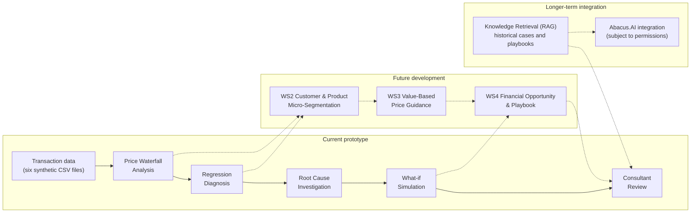

# Project Roadmap

**AI-assisted Pricing Analytics Prototype for Iris Worldwide's pricing consulting business**

This document says what the prototype does today, what is planned, what each step depends on, and what each step
should deliver. The same content is in the app, on the **Project Roadmap** page.

The four workstream descriptions below are our working descriptions, not verified quotations from the industry
partner's original email.

## Status key

| Label | Meaning |
|---|---|
| **Current prototype** | Built, running and tested in this repository |
| **Future development** | Planned core work; **not built** |
| **Longer-term integration** | Optional later extension; **not built** |

## 1. Executive summary

Pricing consultants need to know where a client's list price goes before it becomes profit, and which discounts
deserve a conversation. Today that means working through thousands of transactions by hand. This project builds a
repeatable, explainable workflow that helps consultants do this faster and more consistently.

- **See where the money goes.** The price waterfall follows each transaction from list price to pocket margin,
  separating discounts, rebates, allowances and costs.
- **Know where to look.** A simple regression says how much discount a transaction would normally get. Transactions
  far above that, or above their contract limit, are flagged for review.
- **Understand why, and test ideas.** The root cause view shows which deduction is unusual. The what-if view lets a
  consultant change discount assumptions and compare outcomes before talking to a client.
- **The consultant stays in charge.** Every number can be traced step by step, and the tool supports decisions; it
  does not set prices.

So far the prototype has been built and tested on **synthetic data only**. No savings have been measured.

## 2. How the pieces connect

Today's workflow: **Price Waterfall → Regression Diagnosis → Root Cause Investigation → What-if Simulation →
Consultant Review.**

## 3. What is completed (verified in the repository)

| Component | Where | What it does |
|---|---|---|
| Price Waterfall Analysis | `app/dashboard.py` | List revenue → invoice revenue → pocket revenue → pocket margin, for the whole company, one product or one transaction. Separates on-invoice discounts, four off-invoice adjustments (volume rebate, early-payment discount, credit allowance, promotional allowance), COGS and cost-to-serve. |
| Regression Diagnosis | `app/pages/2_Regression_Diagnosis.py`, `src/regression.py` | Interpretable OLS regression of the total price reduction rate on quantity, customer tier, product, sales channel, region and month, fitted on earlier transactions and tested on later ones. Compares actual and predicted reductions, flags unusually large residuals (adjustable threshold) and discounts above the contract limit. |
| Root Cause and What-If | `app/pages/3_Root_Cause_Simulation.py`, `src/diagnosis.py` | For a flagged transaction, shows which deduction is unusual compared with similar customers. Lets the user change discount assumptions and compare original and hypothetical pocket revenue and pocket margin. |

Supporting work: six synthetic CSV files integrated into one transaction table (`src/preprocessing.py`); documented
data checks (`docs/data_dictionary.md`); automated tests for waterfall reconciliation, table joins, regression
outputs and the what-if calculation (`tests/`); method notes in `docs/`.

**Not built:** `src/leakage_detection.py` and `src/data_generation.py` are empty placeholders, and the notebooks are
empty. Segmentation, price guidance, opportunity sizing, the playbook and knowledge retrieval do not exist yet.

## 4. The four workstreams

### WS1 · Price Leakage & Dispersion Analysis: **largely covered by the current prototype**

*Identify differences between list, invoice and pocket prices; analyze discounts, rebates and other adjustments;
investigate pricing inconsistencies and potential price leakage.*

| | |
|---|---|
| **Built** | Price waterfall; regression diagnosis with contract-limit check; root cause comparison with similar customers |
| **Remaining** | Validate on unseen data and with consultants (Phase A); a direct price-dispersion view for comparable transactions |
| **Depends on** | Real or anonymised client data; partner input on which anomalies matter commercially |
| **Deliverables** | A validated diagnostic workflow; documented data checks, assumptions and limitations |

### WS2 · Customer & Product Micro-Segmentation: **future development**

*Group customers and products by business characteristics; compare purchasing behaviour, profitability and pricing
patterns; develop more targeted pricing strategies.*

| | |
|---|---|
| **Built** | Nothing yet. Customer tier, channel, province, industry and product category already exist in the data and could seed the first segments |
| **Remaining** | Define segments; compare price realization, discounts and profitability within comparable segments; link segments back to the waterfall and regression |
| **Depends on** | Phase A; agreed segmentation criteria; richer customer and product attributes |
| **Deliverables** | Segment definitions; segment-level waterfall and comparison views; a list of segment-specific opportunities |

### WS3 · Value-Based Price Guidance: **future development**

*Develop pricing recommendations from costs, customer value, competitive conditions and constraints; explore floor,
target and stretch corridors; help consultants decide rather than set prices automatically.*

| | |
|---|---|
| **Built** | Nothing yet. The what-if view shows benchmarks (typical and expected discount); these are **not** price recommendations |
| **Remaining** | Explore price corridors; combine internal data with customer value and market information; give transparent recommendations with stated assumptions. Estimate demand elasticity or optimize prices **only** when suitable data and credible assumptions exist |
| **Depends on** | Segmentation (WS2); customer value, competitor and market information; cost and business constraints |
| **Deliverables** | A price-corridor prototype; written explanations of each recommendation and its assumptions |

### WS4 · Financial Opportunity & Playbook: **early demonstration only**

*Quantify potential opportunities under different pricing scenarios; prioritize by impact, feasibility and risk;
develop a reusable, explainable workflow and consulting playbook.*

| | |
|---|---|
| **Built** | The what-if view: the hypothetical effect of lower discounts on one transaction, or on all flagged transactions. It assumes customers buy the same quantity, so it is an illustration, not a forecast |
| **Remaining** | Opportunities by product and customer segment; alternative scenarios with risks and assumptions; prioritization; reusable methodology and consultant-facing outputs, with documented human review |
| **Depends on** | Segmentation (WS2) and price guidance (WS3); volume-response assumptions; a consultant review process |
| **Deliverables** | An opportunity model; a prioritized recommendation list; a consulting playbook |

## 5. Proposed phases

| Phase | Workstream | Focus | Depends on | Proposed deliverable |
|---|---|---|---|---|
| **A. Validate the existing prototype** | WS1 | Verify data joins and financial reconciliation; review data quality and pricing assumptions; evaluate the regression on unseen data; confirm the anomaly flags are statistically and commercially meaningful; document the limits of synthetic data | Consultant review; ideally anonymised real data | Validation report; documented assumptions and limitations |
| **B. Micro-segmentation** | WS2 | Meaningful customer and product segments; compare price realization, discounts and profitability within comparable segments; segment-specific opportunities; connect to the waterfall and regression | Phase A; segmentation criteria | Segment definitions; segment-level views |
| **C. Value-based price guidance** | WS3 | Floor, target and stretch corridors; internal data combined with customer value and market information; transparent recommendations; elasticity or optimization only when data and assumptions are credible | Phase B; market and customer-value information | Price-corridor prototype; recommendation explanations |
| **D. Financial opportunity & playbook** | WS4 | Opportunities by product and segment; scenario comparison with risks; prioritization by impact and feasibility; reusable methodology; documented human review | Phases B and C; review process | Opportunity model; prioritized list; consulting playbook |
| **Later: knowledge retrieval and AI integration** | Supporting | A separate RAG-based search over authorized historical cases, frameworks and playbooks, kept apart from model results; possible integration with Iris's Abacus.AI environment | Data access and security permissions; the core workstreams | To be decided with the partner |

**Already in place for Phase A:** automated tests for waterfall reconciliation, table joins and regression outputs;
documented data checks; a chronological train/test split. These are on synthetic data, so they show the tools work,
not how a real client behaves. **Still to do:** consultant review of the flags, and the items in the table above.

**Knowledge retrieval is optional.** It is a supporting capability, not a replacement for the four pricing
workstreams, and it must not blur historical evidence with model predictions.

## 6. Important limitations

- All data is **synthetic**. The prototype has not been validated on real client transactions.
- A statistical anomaly is **not** confirmed price leakage. There may be good commercial reasons for it.
- What-if results depend on assumptions about customer behaviour and transaction volume.
- Regression shows patterns, not **causal effects** of changing a price.
- Value-based recommendations will need market, customer and operational information we do not have yet.
- Human consultant judgment remains essential.

This document does not claim any financial savings, model performance, client approval or completed workstream
deliverable.

## Related documents

[README](README.md) · [Regression Diagnosis](docs/regression_diagnosis.md) ·
[Root Cause and What-If](docs/root_cause_simulation.md) · [Methodology](docs/methodology.md) ·
[Data dictionary](docs/data_dictionary.md)
